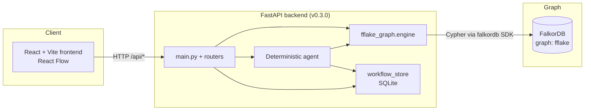

```markdown
# FFlake

**Graph-native capability-path investigation for security**

Discover multi-hop reachability from identities to sensitive resources, score risk with graph evidence, propose interventions, and verify them in simulation — without mutating production permissions.

[](https://f-flake.vercel.app)
[](https://fflake-backend.onrender.com)
[](https://www.falkordb.com)
[](https://www.wemakedevs.org/hackathons/falkordb)

---

## Live Demo

**Frontend:** [https://f-flake.vercel.app](https://f-flake.vercel.app)  
**Backend API:** [https://fflake-backend.onrender.com](https://fflake-backend.onrender.com)  
**Graph store:** FalkorDB (Cloud / local)

> The free Render backend may cold-start after idle periods. Wait a few seconds on the first request if the health check is slow.

---

## Overview

Modern environments rarely grant a single obvious dangerous permission. Risk often appears as **indirect, multi-hop capability paths**: an external automation identity that can trigger a webhook, which can assume a deployment principal, which can reach production secrets.

FFlake models these relationships as a graph in FalkorDB and helps investigators:

1. **Discover** bounded capability paths between a source and a sensitive target.
2. **Score** paths using relationship risk values and hop depth.
3. **Recommend** candidate edge cuts (including an exact minimum-cost hitting set over the enumerated paths).
4. **Simulate** the effect of excluding a candidate relationship.
5. **Record** investigation runs and human-reviewed remediation proposals.

The analysis is **deterministic and simulation-only**. It does not call an LLM, does not autonomously change permissions, and does not claim exploitability — only graph reachability evidence.

---

## Problem

Access control is usually inspected edge-by-edge. A bot may be allowed to call a webhook; a runner may be allowed to assume a role; a role may be allowed to read a vault. Each individual grant can look reasonable. Together they form a path from an untrusted principal to highly sensitive data.

Traditional list- or policy-based reviews struggle to surface these chains. Graph-native path search makes the full chain visible, rankable, and testable under simulated remediation.

---

## How FFlake Works

| Step | Action | What happens |
|------|--------|--------------|
| 1 | Seed (optional) | Load the fictional demo graph (`external-bot` → `prod-secrets`) |
| 2 | Discover | Query FalkorDB for directed paths of 1–6 hops over allowed relationship kinds |
| 3 | Analyze | Score paths, rank candidate edges by impact, compute a minimum-cost cut over the enumerated set |
| 4 | Propose | Create a human-review proposal that names a specific edge to restrict |
| 5 | Decide | Approve or reject the proposal (no infrastructure is modified) |
| 6 | Verify | Re-run path search while excluding the candidate edge; compare before/after counts |

All verification steps set `simulation_only: true` and explicitly state that the underlying FalkorDB relationships are **not** deleted or altered.

---

## Key Features (implemented)

- **Bounded multi-hop path discovery** over `FFAsset` nodes and `FF_REL` relationships (max 6 hops, limit 50)
- **Risk scoring** — sum of edge risk values → bands: low / moderate / high / critical
- **Candidate fix ranking** — edges ordered by paths blocked and remaining path count after simulated exclusion
- **Exact minimum-cost cut** over the set of enumerated paths (not a claim of global optimality)
- **Simulation verification** — exclude an edge ID from the query; never mutate the graph
- **Deterministic agent endpoint** — keyword-driven tool selection (`analyze_path`, `verify_simulated_cut`); no LLM
- **Investigation history & proposals** — SQLite-backed workflow store with pending → approved/rejected → verified lifecycle
- **React Flow visualization** of the primary path, selected edge, and simulated cut state
- **Honest claim boundaries** returned on every analysis and verification response

---

## Architecture



**Data flow (typical investigation)**

1. Frontend posts source/target (or agent request string) to the backend.
2. Engine issues a parameterized Cypher path query against FalkorDB.
3. Paths are scored, candidate edges ranked, and an optional minimum-cost cut computed.
4. Results are returned with explicit claim-boundary text.
5. Optional workflow steps persist the run and any remediation proposal to local SQLite.

---

## Technology Stack

| Layer | Technology |
|-------|------------|
| Frontend | React 19, TypeScript, Vite 8, @xyflow/react 12 |
| Backend | FastAPI, Pydantic v2, Python 3 |
| Graph | FalkorDB (Python SDK `falkordb>=1.0.0`) |
| Workflow store | SQLite (`backend/data/fflake_workflow.db`) |
| Deployment | Frontend → Vercel · Backend → Render · Graph → FalkorDB Cloud / Docker |

---

## Getting Started

### Prerequisites

- Python 3.10+
- Node.js 18+
- A running FalkorDB instance (Docker or FalkorDB Cloud)

```bash
# Local FalkorDB (example)
docker run -p 6379:6379 -d --name falkordb falkordb/falkordb:latest
```

### Backend

```bash
cd backend
python -m venv .venv

# Windows PowerShell
.\.venv\Scripts\Activate.ps1

# macOS / Linux
source .venv/bin/activate

pip install -r requirements-fflake-graph.txt
# optional for tests
pip install -r requirements-dev.txt

# optional connection overrides
# $env:FALKORDB_HOST = "localhost"          # PowerShell
# export FALKORDB_HOST=localhost            # bash
# same for FALKORDB_PORT, FALKORDB_GRAPH, FALKORDB_PASSWORD

uvicorn main:app --reload --host 127.0.0.1 --port 8000
```

Open interactive docs: [http://127.0.0.1:8000/docs](http://127.0.0.1:8000/docs)

### Frontend

```bash
cd frontend
npm install
npm run dev
```

The UI defaults to `http://127.0.0.1:8000`. Ensure the backend is running and CORS origins include `http://localhost:5173`.

---

## Configuration & Environment Variables

Defined in `backend/fflake_graph/config.py`:

| Variable | Default | Purpose |
|----------|---------|---------|
| `FALKORDB_HOST` | `localhost` | FalkorDB host |
| `FALKORDB_PORT` | `6379` | FalkorDB port |
| `FALKORDB_GRAPH` | `fflake` | Graph name |
| `FALKORDB_PASSWORD` | _(empty)_ | Optional password |

No secrets are committed. The workflow SQLite file lives under `backend/data/` (git-ignored).

---

## Example Investigation (demo graph)

The seeded demo models a fictional chain:

```
external-bot  --CAN_TRIGGER-->  webhook-runner
webhook-runner  --CAN_ASSUME-->  deploy-identity
deploy-identity  --CAN_ACCESS-->  prod-secrets
```

**Via API**

```bash
# 1. Seed (idempotent upsert)
curl -X POST http://127.0.0.1:8000/api/graph-hacks/demo/seed

# 2. Discover paths
curl "http://127.0.0.1:8000/api/graph-hacks/paths?source=external-bot&target=prod-secrets"

# 3. Full analysis (paths + candidate fixes + min-cost cut)
curl -X POST http://127.0.0.1:8000/api/graph-hacks/analyze \
  -H "Content-Type: application/json" \
  -d '{"source":"external-bot","target":"prod-secrets"}'

# 4. Simulate cutting a suggested edge
curl -X POST http://127.0.0.1:8000/api/graph-hacks/verify \
  -H "Content-Type: application/json" \
  -d '{"source":"external-bot","target":"prod-secrets","cut_edge_id":"edge-deploy-secrets"}'
```

**Via the UI**

1. Open the live app or local frontend.
2. Confirm “Graph connected”.
3. Click **Seed demo graph** (if needed).
4. Leave source `external-bot` / target `prod-secrets` and run **Analyze**.
5. Select a candidate edge and run **Verify simulation**.
6. Optionally create a proposal, approve it, and re-verify through the workflow panel.

Expect a single high-risk path, ranked candidate edges (including remediation cost), and a simulation result that reports whether any paths remain after the cut.

---

## Custom Scenarios & Limitations

- Source and target **must already exist** as `FFAsset` nodes with matching `id` values. Entering arbitrary names does not create nodes or relationships.
- Path search is limited to **1–6 hops** and **50 results**, and only the relationship kinds listed in `ALLOWED_EDGE_KINDS`.
- Empty path results mean “no matching path under these constraints,” not “no possible route exists in the wider environment.”
- Minimum-cost cut is exact **only for the enumerated path set**.
- Simulation never deletes or rewrites FalkorDB data. Real remediation requires an approved external change followed by a fresh verification against the updated graph.

---

## API Surface (verified)

| Method | Path | Purpose |
|--------|------|---------|
| GET | `/health` | Backend + graph connectivity |
| GET | `/api/graph-hacks/health` | Graph-hacks health |
| POST | `/api/graph-hacks/demo/seed` | Upsert demo nodes/edges |
| GET | `/api/graph-hacks/paths` | Enumerate paths |
| POST | `/api/graph-hacks/analyze` | Paths + candidates + min-cost cut |
| POST | `/api/graph-hacks/verify` | Simulated edge exclusion |
| POST | `/api/agent/run` | Deterministic investigation agent |
| GET/POST | `/api/workflows/investigations` | Investigation history |
| GET/POST | `/api/workflows/proposals` | Create / list proposals |
| POST | `/api/workflows/proposals/{id}/decision` | Approve or reject |
| POST | `/api/workflows/proposals/{id}/verify` | Simulation verify (approved only) |

---

## Testing

Unit tests live under `backend/tests/` and use pytest with monkey-patched queries (no live database required for the engine suite).

```bash
cd backend
pip install -r requirements-dev.txt
pytest tests/ -v
```

Existing suites cover risk banding, empty-path handling, simulated-cut verification logic, and minimum-cost cut selection.

---

## Security & Safety Considerations

- **Simulation boundary** — Every verify response includes `simulation_only: true` and states that the relationship is only excluded from the query, not deleted.
- **Human approval gate** — Proposals start as `pending`. Only `approved` proposals may be simulation-verified. The API never reports that real infrastructure was changed.
- **Credential handling** — FalkorDB password is read from the environment only; never logged or returned by endpoints.
- **CORS** — Currently restricted to local Vite origins in the checked-in `main.py`. Production deployments should tighten origins further.
- **Claim language** — Responses repeatedly distinguish “capability path for investigation” from “confirmed vulnerability.”

---

## Current Limitations & Roadmap

**Implemented today**

- Graph-backed path discovery, scoring, candidate ranking, min-cost cut, simulation verification
- Deterministic tool-selecting agent
- SQLite investigation & proposal workflow
- React investigation UI with path visualization

**Not implemented (explicitly out of scope for this version)**

- LLM-based autonomous reasoning or free-form natural-language planning
- Live permission changes or cloud IAM adapters
- Multi-tenant isolation
- MCP tool surface
- Automatic creation of graph entities from arbitrary user input

Future increments (documented in `docs/`) include persistent episodic memory, sandbox remediation adapters, and MCP exposure of the same graph tools.

---

## Hackathon Context

Built for **[Graph Hacks: Context for AI Agents](https://www.wemakedevs.org/hackathons/falkordb)** (WeMakeDevs × FalkorDB, 15–18 October 2026).

FalkorDB is the primary graph database and performs the core multi-hop capability-path queries that drive every investigation. The project sits in the “Agents That Act on Connected Data” spirit: the graph is the decision substrate, not a decoration.

---

## Contributing

1. Fork and clone the repository.
2. Keep changes focused; prefer small, reviewable PRs.
3. Run the existing pytest suite before opening a PR.
4. Do not commit secrets, `.env` files, or the local SQLite workflow database.
5. Preserve the honest claim-boundary language in any new analysis endpoints.

---

## License

No license file is present in the repository at the time of writing. All rights remain with the authors until a license is added. Contact the maintainers before redistributing or commercial use.

---

## Repository

[https://github.com/revv-a/FFlake](https://github.com/revv-a/FFlake)
```
